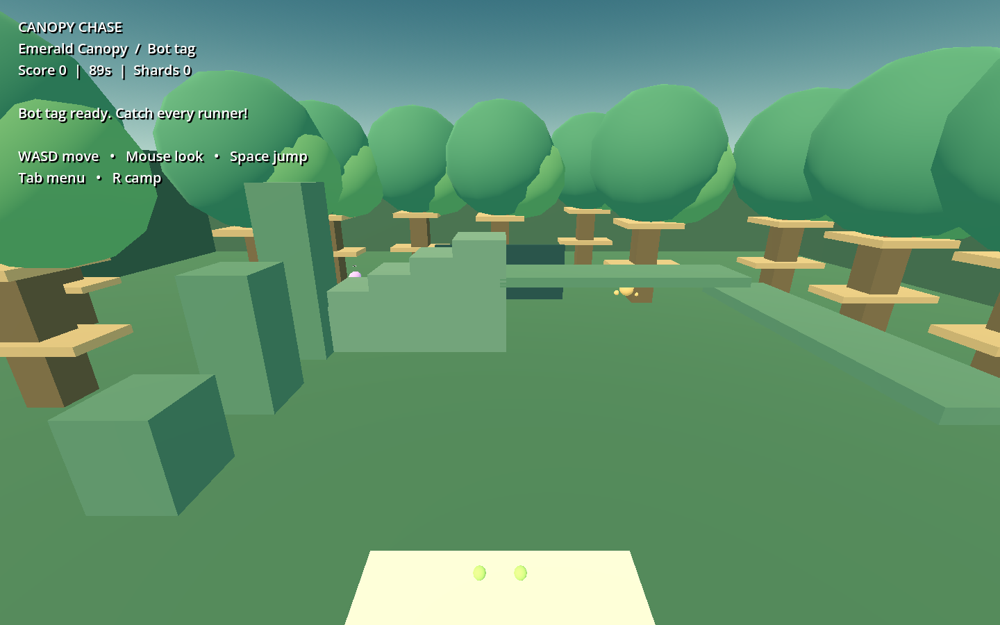

# Canopy Chase

An original Quest VR playground with real direct-connect multiplayer, arm-driven climbing, tag, and offline practice modes. **Early prototype with simple procedural art.** Not affiliated with Gorilla Tag.

## Download and install

[Download the Quest APK (169.7 MB)](https://github.com/markovandermerwe549-ops/literate-octo-funicular/raw/refs/tags/v0.2.0/builds/CanopyChase-Quest-Multiplayer.apk) · [All release files](https://github.com/markovandermerwe549-ops/literate-octo-funicular/releases/tag/v0.2.0)

Enable Quest Developer Mode, connect over USB, accept USB debugging, and sideload the APK using SideQuest. Or run:

```sh
adb install -r CanopyChase-Quest-Multiplayer.apk
```

Launch **Canopy Chase** from **Unknown Sources**. Targets Quest 2, Quest 3/3S, and Quest Pro with tracked Touch controllers. This is a development-signed ARM64 APK.

**No physical Quest was available for testing. Installation, controller tracking, comfort, audio, and headset frame rate still need device testing. Real ENet multiplayer was verified using three separate desktop processes. No voice chat or automatic matchmaking.**



## Play with friends (version 0.2.0)

1. Install the same 0.2.0 APK on each Quest. For the simplest setup, connect all headsets to the same Wi-Fi network without guest/client isolation.
2. One player opens the menu with **X or B**, then selects **HOST ROOM**. The menu displays the host's IPv4 address.
3. Friends open their menus, use **CLEAR** and the number/dot keypad to enter that host IP, then select **JOIN IP**. Desktop players can type into the address field.
4. The host chooses **SOCIAL**, **PLAYER TAG**, or **PLAYER INFECTION**, changes arenas with the map buttons, and restarts rounds with **RESTART**. Clients receive the same map and round state automatically.
5. Use **LEAVE ROOM** to return to offline practice. Keep the hosting headset awake with the app open. If the host leaves or closes the app, everyone returns to offline play.

Rooms support **8 players including the host**. Players' head rotation, hand positions, colors, and movement replicate at 20 Hz with avatar smoothing. The host checks hand-to-body contact, map obstruction, round timers, tags, and infection results. Menus stop your local movement but do **not** pause the shared round; you remain taggable.

For friends on different networks, the host must forward **UDP 7777** to the hosting device, allow that port through applicable firewalls, and give friends their reachable **public IPv4 address**. Double NAT or carrier-grade NAT may prevent hosting without additional network setup. This build has no relay, automatic NAT traversal, persistent public server, room codes, or matchmaking service. Do not enter passwords or router credentials in the game.

This is a casual prototype: movement comes from each player's device, with basic pose bounds/reach validation; it is not a competitive anti-cheat system. All players must use version 0.2.0. Bot/race/crystal modes remain available offline.

## Features

- Four arenas: Emerald Canopy, Sunstone Canyon, Glacier Hollow, and Neon Overgrowth.
- Offline: five modes per arena: free roam, bot tag, infection, time trial, and crystal hunt.
- Palm pushing, grip climbing, release momentum, body collisions, and haptics.
- Five bots with obstacle steering; infection can spread between bots.
- Nine race gates, saved best times, 30 collectible crystals per arena, and 90-second rounds.
- Collectible shards, five unlockable hand colors, and local progression saves.
- Day/night lighting, movement speed settings, stick assist, and 30/45-degree snap turning.
- VR menu, head-mounted status display, camp reset, and four original two-minute ambient scores.

## Quest controls

| Input | Action |
| --- | --- |
| Push solid surfaces with your palms | Propel yourself |
| Grip near a solid surface, then pull | Climb; release to carry momentum |
| Either hand touches a bot | Tag |
| Left stick | Assisted movement, when enabled |
| Right stick | Snap turn |
| X or B | Toggle menu |
| Y | Return to camp |
| Right controller pointer + trigger | Select menu buttons |

## Source and building

Import `project.godot` into **Godot 4.6.3**. The OpenXR Vendors 5.1.0 addon is included with its licenses. If no OpenXR runtime is available, use `godot --path . --xr-mode off` for the desktop preview. Desktop controls: WASD, mouse, Space, Tab, and R.

For Quest exports, install matching Godot Android templates and use **Project > Install Android Build Template**. Configure a full JDK and the Android SDK in Editor Settings. This build used JDK 17, Android API 36, and build tools 36.1.0. Export the included **Quest** preset with your own configured signing key. Generated build folders and private keys are excluded.

The prebuilt APK in `builds/` is stored with Git LFS. Use the direct APK download link above, or install Git LFS before cloning. A GitHub source ZIP may contain an LFS pointer in place of the APK; use the direct download for installation.

The APK is larger than 100 MB because it includes used stereo ambient audio and the native VR runtime, with no size-only filler.

## Validation

The multiplayer integration test runs an actual ENet host and two separate clients over loopback, verifying pose replication, host-only map controls, shared map changes, real-player tag transfer and scoring, a late join, infection completion, avatar cleanup, and recovery after the host disconnects. Run with:

```sh
python3 tests/run_network_test.py
```


All 20 offline arena/mode combinations passed headless checks, plus collection rewards, race completion, bot tagging, infection victory, settings, reset, and save actions. A Linux OpenGL desktop render was inspected. APK signature, alignment, archive integrity, ARM64 libraries, and Quest/OpenXR manifest settings passed checks. See [build details](docs/BUILD-INFO.txt) and [full installation/build guide](START-HERE.txt).

## License

Original game code, procedural content, icon, and audio: [MIT](LICENSE.txt). Godot and bundled vendor components retain their own licenses; see the included notices and addon license files.
